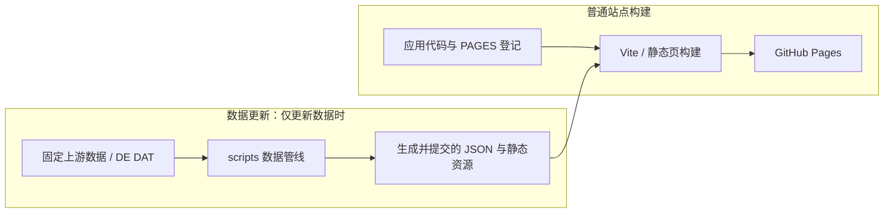
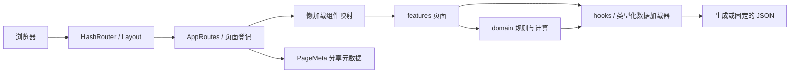

# 系统架构

## 产品边界

本站是 AoE2 DE 的简体中文资料与计算工具，提供游戏资料查询、对局计划、经济计算、战术工具和赛后复盘。它是静态客户端应用：不读取游戏客户端的实时局势，不提供账号或服务端存档，也不把计算结果表述为最佳策略或胜负保证。数据与工具只覆盖当前明确建模的范围。

## 产品结构

首页与导航的四个任务组由 [SECTION_GROUPS](../src/shared/nav/pageRegistry.ts) 定义：**新手入门**、**对局计划**、**经济计算**和**资料**。前者帮助理解游戏并开始练习；计划组支持开局、侦察、搭配、团队协作和复盘；经济组比较资源、供给与投入收益；资料组提供文明、单位、科技和建筑目录。

主要代码边界：应用与路由在 [src/app](../src/app/)；各页面在 [src/features](../src/features/)；共享组件与样式在 [src/shared](../src/shared/)；纯领域规则在 [src/domain](../src/domain/)；运行时数据入口在 [src/data](../src/data/)；生成流程在 [scripts](../scripts/)。

## 构建与部署

普通 `npm run build` 使用仓库中已跟踪的生成数据和应用代码；它不下载 DAT。仅在数据更新时，按固定来源运行生成管线并复核提交产物。静态托管无服务端运行层，来源固定与生成器让数据更新可复现。步骤见 [DATA-UPDATE.md](DATA-UPDATE.md)，正式发布见 [RELEASING.md](RELEASING.md)。

## 浏览器运行时

## 分层与依赖

可执行边界由 [scripts/check-layers.mjs](../scripts/check-layers.mjs) 检查：功能页不能跨引用其它功能页；shared 层不能依赖 features 或 app；domain 不依赖 React、页面、应用壳或 shared/ui。纯领域函数易于隔离验证，避免 UI 状态和游戏计算相互渗透。

核心 JSON 的直接读取只允许通过检查器的 `LOADERS` 集合中的七个文件：
[src/data/index.ts](../src/data/index.ts)、
[src/data/raw/civs.ts](../src/data/raw/civs.ts)、
[src/data/raw/units.ts](../src/data/raw/units.ts)、
[src/data/raw/techs.ts](../src/data/raw/techs.ts)、
[src/data/raw/buildings.ts](../src/data/raw/buildings.ts)、
[src/data/raw/eco.ts](../src/data/raw/eco.ts) 和
[src/domain/datEffects.ts](../src/domain/datEffects.ts)。
新增入口须同步更新分层检查与本说明；页面不能任意直接导入核心 JSON。

## 路由、导航与元数据

[src/app/App.tsx](../src/app/App.tsx) 使用 React Router 的 `HashRouter`，地址使用 hash 路径以适配静态托管并支持可复制链接。[src/shared/nav/pageRegistry.ts](../src/shared/nav/pageRegistry.ts) 的 `PAGES` 登记路由、分组和页面说明；同一文件中的 `SECTION_GROUPS` 定义任务导航。[src/shared/nav/sections.ts](../src/shared/nav/sections.ts) 从登记派生导航、首页分组等列表；[src/app/pageRegistry.tsx](../src/app/pageRegistry.tsx) 将登记项映射到懒加载组件；[src/app/routes.tsx](../src/app/routes.tsx) 从该注册生成路由并渲染 PageMeta。分享与静态页元数据使用同一登记来源，避免平行清单漂移。新增页面应扩展登记、组件映射及相关验证。

注册表把路由、导航和元数据的维护集中在一起；组件延迟加载则避免首次请求下载所有功能页面。这是当前实现的组织方式，不是额外的服务器端目录或内容服务。

## 数据、状态与来源

文明目录随主包导入；[src/data/index.ts](../src/data/index.ts) 的 `loadCore()` 懒加载单位、科技、建筑及介绍数据并建立索引，失败时清除缓存 Promise 允许重试；科技树另行懒加载。raw 层的登记入口原样转出数据，带派生字段的数据由类型化入口构造。

[scripts/data_sources.json](../scripts/data_sources.json) 固定上游数据身份；[DATA-UPDATE.md](DATA-UPDATE.md) 说明更新流程。[scripts/build_data.py](../scripts/build_data.py)、[scripts/effects_build.py](../scripts/effects_build.py)、[scripts/eco_build.py](../scripts/eco_build.py) 等脚本生成站点数据。[src/data/effects.json](../src/data/effects.json) 是从 DAT 提取的效果数据；[src/domain/effects.ts](../src/domain/effects.ts) 将 DAT 结果与显式手工回退表合成运行时注册。`TECH_EFFECTS` 是该合成层的登记结果，不是生成文件：不要把它当作来源编辑；DAT 提取见 [scripts/effects_build.py](../scripts/effects_build.py)，手工回退见 [effects.manual.ts](../src/domain/effects.manual.ts) 与 [buildingEffects.manual.ts](../src/domain/buildingEffects.manual.ts)。固定来源只证明输入身份，不意味着所有游戏机制均已建模或验证。开局模拟的复现方式与未知边界见[来源说明](data/BUILD-SIM-SOURCES.md)。

可分享的页面状态写入功能自己的 hash 路由查询参数；仅用户设备偏好或适合本地恢复的草稿使用 `localStorage`。主题偏好保存在本地，支持 `light`、`dark`、`system`，并由 [src/app/theme](../src/app/theme/) 按系统偏好解析。各功能定义自己的状态恢复语义，不假设有全局持久化状态库。

## 扩展点

- 新页面：更新 `PAGES` 与 [src/app/pageRegistry.tsx](../src/app/pageRegistry.tsx)；只有新增任务组时才扩展 `SECTION_GROUPS`。
- 可复用界面：优先使用 [src/shared/ui](../src/shared/ui/)；样式令牌见 [tokens.css](../src/shared/styles/tokens.css)。
- 新计算：在 `src/domain` 实现纯逻辑并补充针对正常、边界和错误输入的测试。
- 数据变化：更新固定来源或生成器并复现产物，不手改生成结果。
- 开局模拟：按 [src/domain/buildSimMechanisms.ts](../src/domain/buildSimMechanisms.ts)、[buildSimEffects.ts](../src/domain/buildSimEffects.ts) 和 [buildSimCoverage.ts](../src/domain/buildSimCoverage.ts) 的注册与来源门控扩展；未知或不完整来源继续拒绝应用。

## 验证与交付

`npm run build` 执行类型检查、Vite 构建和静态页生成；`npm run lint` 包含设计索引、颜色与 CSS 检查。分层边界需单独运行 `npm run lint:layers -- --strict`。测试范围与当前 CI 以 [TESTING 第 6 节](TESTING.md#ci-659-validation)和工作流为准。普通部署不等同于手动 full 测试；main 上的 CI/Deploy 成功后发布到 GitHub Pages，正式 Release 使用已部署产物，见 [RELEASING.md](RELEASING.md)。
