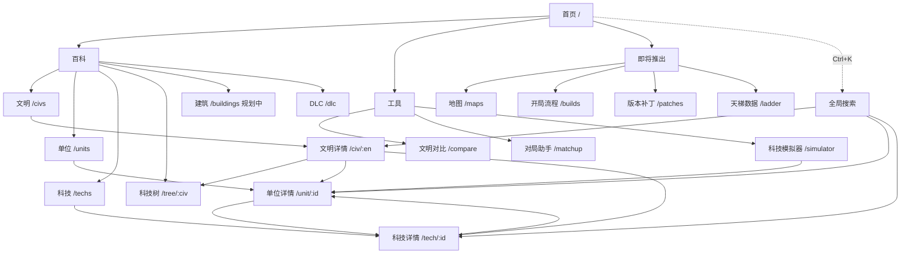

# 信息架构与交互重构方案（IA Redesign）

> 状态：提案 / 预览版（分支 `redesign`，预览地址 https://linhongcun.github.io/aoe2-analyzer/preview/ ）。正式站点未改动。

## 1. 现状问题

| 问题             | 表现                                                                                                                      |
| ---------------- | ------------------------------------------------------------------------------------------------------------------------- |
| 扁平标签栏       | 7 个平级按钮（文明分析/单位/科技/科技树/DLC/对比/对局），百科内容与工具混在一起；再加建筑、地图、开局等模块会继续横向膨胀 |
| 无首页           | 打开即是文明网格，新用户不知道还有单位、科技、模拟器等功能                                                                |
| 详情页布局不一致 | 文明页两栏 + 雷达；单位页把属性、模拟器、文明、说明纵向堆叠，页面很长；科技页又是另一种排版                               |
| 可发现性差       | 科技模拟器藏在单位页底部；没有跨类型搜索，只能先进对应列表再搜                                                            |
| 缺少位置感       | 没有面包屑，只靠“返回”按钮（history.back），从外部链接进入时返回会离开站点                                                |
| 移动端           | 标签栏换成多行，占满首屏；详情两栏在窄屏挤压                                                                              |
| 扩展位缺失       | 新模块没有统一的注册方式与占位                                                                                            |

## 2. 新信息架构

### 2.1 顶部导航（分组）

- **百科**：文明 · 单位 · 科技 · 科技树 · 建筑（规划中）· DLC
- **工具**：文明对比 · 对局助手 · 科技模拟器
- 右侧：**全局搜索**按钮（`Ctrl/Cmd + K`）
- 品牌标题点击回首页；顶栏吸顶

模块统一登记在 `src/shared/nav/sections.ts`（key、路径、图标、简介、`status: 'planned'`），导航、首页卡片、面包屑、搜索中的“页面”结果都从这一份注册表生成。

### 2.2 首页 / 总览（`#/`）

1. Hero：站点名 + 一句话说明 + 大号搜索框（打开命令面板）+ 热门文明快捷入口 + “全部 56 个文明”
2. **百科**入口卡片（图标 + 名称 + 简介）
3. **工具**入口卡片
4. **即将推出**：建筑、地图、开局流程、版本补丁、天梯数据（虚线卡片，标“规划中”）

### 2.3 全局搜索（命令面板）

- 快捷键 `Ctrl/Cmd + K`、顶栏按钮、首页搜索框均可打开；`Esc` 关闭
- 一个索引覆盖：页面、文明（56）、单位（248）、科技（199），中英文均可
- 打分：完全匹配 > 前缀 > 英文单词前缀 > 包含；同分按 页面 > 文明 > 单位 > 科技
- 方向键选择，Enter 跳转；结果带图标、中英名、所属建筑/类型标签
- 纯逻辑在 `src/domain/search.ts`（有单测）

### 2.4 统一详情页模板（`shared/ui/layout.tsx` → `DetailPage`）

```
面包屑：首页 > 模块 > 当前项
┌──────────────────────────────────────────────┐
│ [大图标] 中文名 English  [DLC 徽章] [标签…]   │
├ 概览 | 数据 | 科技 | 相关 ───────────────────┤
│ 标签页内容                       │ 右侧栏：    │
│                                  │ 相关链接块  │
└──────────────────────────────────┴────────────┘
```

| 页面         | 标签页                                                                                                       | 右侧栏                                               |
| ------------ | ------------------------------------------------------------------------------------------------------------ | ---------------------------------------------------- |
| 文明         | 概览（定位/特色兵种/加成/团队加成/优劣势/位置/开局）· 数据（雷达 + 团战位置）· 科技（独特科技 + 科技树入口） | 独特单位、快速入口（科技树/对比/对局）、同资料片文明 |
| 单位         | 概览（造价/属性表/攻防类别/升级研究/说明）· 科技模拟器 · 相关（相关科技/拥有文明）                           | 升级路线（纵向）、相关科技、可用文明                 |
| 科技         | 概览（费用/效果/涉及单位）· 文明（可研究/不可研究）                                                          | 科技链、涉及单位                                     |
| 建筑（规划） | 概览 · 可生产 · 可研究 · 相关                                                                                | 所在时代、相关建筑                                   |

规则：头部永远是“图标 + 中英名 + DLC + 标签”；第一个标签页永远是“概览”；“相关”类链接优先放右侧栏；窄屏右侧栏落到正文下方。
单位 URL 带文明（`#/unit/569/Franks/...`）或 `?tab=sim` 时默认打开“科技模拟器”标签，旧分享链接保持可用。

### 2.5 面包屑

所有列表与详情页顶部：`首页 > 模块 > 当前项`，模块由路由自动匹配注册表；替代原“返回”按钮（浏览器返回仍可用）。

### 2.6 列表页统一筛选栏

列表页统一结构：面包屑 → 标题 + 说明 → 筛选栏（搜索框 + 下拉筛选 + 计数，统一面板样式 `.fbar`）→ DLC 图标条 → 网格。筛选条件跨页面保留。

### 2.7 移动端

- ≤900px：顶栏只保留菜单按钮、站名、搜索图标；导航变为下拉抽屉，按“百科 / 工具”分组；跳转后自动收起
- 详情页两栏改为单栏，右侧栏落到正文下方；标签页可横向滑动
- 科技树保持横向滚动

### 2.8 扩展位（规划中模块）

| 模块     | 路由                            | 数据来源设想                                                | 详情模板标签页         |
| -------- | ------------------------------- | ----------------------------------------------------------- | ---------------------- |
| 建筑     | `#/buildings`、`#/building/:id` | aoe2techtree `data.Building`                                | 概览 · 可生产 · 可研究 |
| 地图     | `#/maps`、`#/map/:id`           | 手工整理排位地图池                                          | 概览 · 推荐文明        |
| 开局流程 | `#/builds`、`#/build/:id`       | 手工/社区 build order JSON（步骤、人口、时间）              | 步骤时间轴 · 适用文明  |
| 版本补丁 | `#/patches`、`#/patch/:ver`     | 官方补丁说明，按文明/单位关联                               | 改动列表 · 受影响项    |
| 天梯数据 | `#/ladder`                      | aoe2companion / aoe2insights 公开统计（需确认授权与可达性） | 胜率 · 出场率 · 按分段 |

新增模块步骤：在 `sections.ts` 登记 → `features/<x>` 实现 → `routes.tsx` 注册（替换 Planned 占位）→ 在 `useSearchIndex` 中加入索引 → 详情页复用 `DetailPage`。

## 3. 路由表（旧链接全部保留）

| 路由                                                     | 页面                   | 说明                             |
| -------------------------------------------------------- | ---------------------- | -------------------------------- |
| `#/`                                                     | 首页                   | **变化**：原为文明列表           |
| `#/civs`、`#/list`（旧 `#list`）                         | 文明列表               | `#/list` 重定向到 `#/civs`（#9） |
| `#/civ/:en`（旧 `#civ/X`）                               | 文明详情               |                                  |
| `#/units`、`#/unit/:id[/:civ/:age/:ids/:team]`           | 单位列表 / 详情        | 带文明参数时默认打开模拟器标签   |
| `#/unit/:id?tab=sim`                                     | 单位详情（模拟器标签） | 新增                             |
| `#/techs`、`#/tech/:id`                                  | 科技列表 / 详情        |                                  |
| `#/tree`、`#/tree/:civ`                                  | 科技树                 | `#/tree` 重定向到默认文明        |
| `#/dlc`                                                  | DLC                    |                                  |
| `#/compare`、`#/matchup`                                 | 工具                   |                                  |
| `#/simulator`                                            | 模拟器入口（选单位）   | 新增                             |
| `#/buildings` `#/maps` `#/builds` `#/patches` `#/ladder` | 规划中占位             | 新增                             |
| 其他                                                     | 首页                   | 原为文明列表                     |

旧 hash（无前导 `/`）由 HashRouter 自动规范化，所有既有分享链接可用。

## 4. 站点地图



## 5. 待确认问题

见预览汇报中的“需要你确认”。
