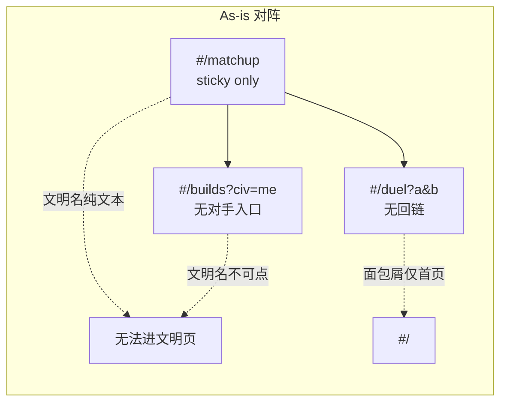
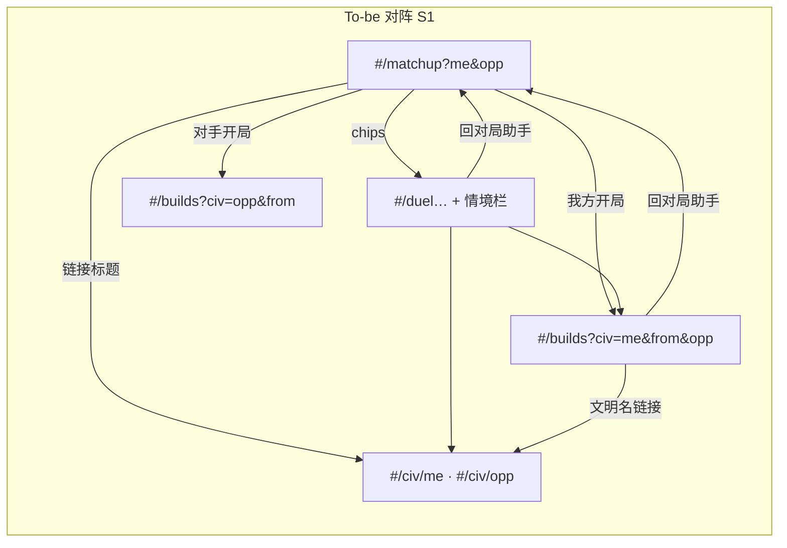
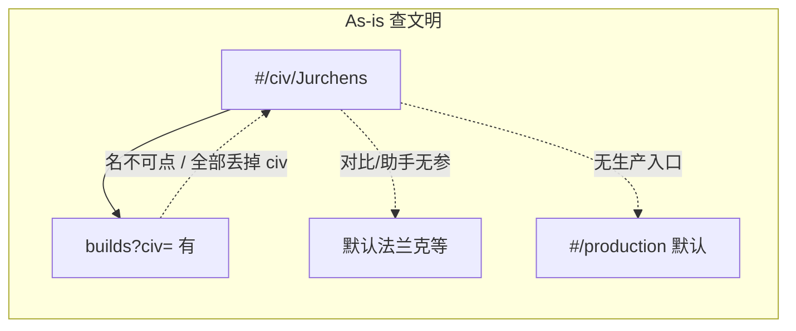
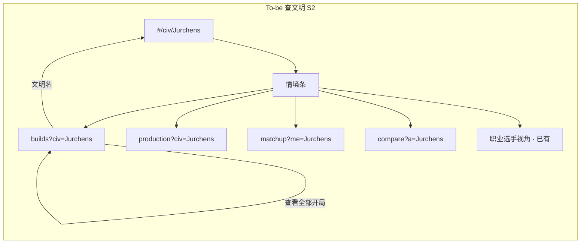

# #517 站点串联 · 信息架构规格

> 作者：Jony Ive · 体验设计 · 2026-10-30（Asia/Shanghai）  
> 依据：[#517](https://github.com/linhongcun/aoe2-analyzer/issues/517) 断点清单；产品范围：两条主路径，对阵优先；少开新站；不大改视觉。  
> 用途：Steve 拆可交付子 issue；Codex 实现 S1 时不得自行发明产品决策。

---

## 1. 目标与原则

**目标**：让玩家沿任务路径一路点下去（对阵 → PK / 开局 / 文明；查文明 → 开局 / 生产 / 对阵 / 选手），不必回首页或自己搜。

**原则**：

1. **情境入口 + 回链 + 参数透传**；不新建微站或总览页。
2. **URL 即真相**：选定双方文明后，地址栏可复制分享；本地 sticky 仅作「无 query 时的回退」。
3. **复用既有参数名**；仅对局助手补一对语义清晰的文明参数。
4. **真链接**：凡可导航处用 `<a href>` / `Link`，支持新标签打开与复制地址。
5. **轻编辑风**：Inter、accent `#a65a14`、muted `#636366`；图标只写 Lucide 名，禁止 emoji。

---

## 2. 上下文对象

逻辑上下文（各页读写子集）：

```ts
type SiteContext = {
  meCiv: string;      // 文明 en，如 Mongols / Jurchens（必填于对阵路径）
  oppCiv?: string;    // 对手文明 en；查文明单方路径可缺
  bo?: string;        // 开局 id，对应 builds?bo=
  unit?: string;      // 单位 id，对应 /unit/:id
  from?: 'matchup' | 'duel' | 'builds' | 'civ' | 'compare' | 'production' | 'players' | 'events';
};
```

**写入规则**：

| 来源页 | 写入 |
| --- | --- |
| `#/matchup` | `meCiv` + `oppCiv`（URL 主源）；sticky `mu.a`/`mu.e` 仅无 query 时回退 |
| `#/duel` | 从 `a=`/`b=` pack 解析双方 civ → 情境栏展示；回助手时带 `me`/`opp` |
| `#/builds` | 保留 `civ=`；若带 `from=matchup` 且有 `opp=`，情境栏显示对手入口 |
| `#/civ/:en` | `meCiv = :en`；进入对阵时预填 `me=` |
| `#/unit/:id` | 若带 `civ=` 则文明名链回 `#/civ/{civ}`；保留 `me`/`opp`/`from` 供回程 |

**不入库**：不引入全局 Context Provider 新架构；优先 query string + 现有 sticky 回退。实现细节留给工程，本规格只定「可见 URL 与链接必须带什么」。

---

## 3. URL 参数约定

### 3.1 复用（不得改名）

| 参数 | 现有用法 | 本规格 |
| --- | --- | --- |
| `civ=` | `#/builds?civ=Mongols` | 继续表示「当前开局/单方工具所属文明」 |
| `bo=` | `#/builds?bo=…` | 不变 |
| `a=` / `b=` | `#/duel?a=<unit.civ.age…>&b=…` | **仍只用于 PK 单位 pack**，不对局助手复用 |
| `tab=` | 详情页标签（若已有） | 保留 |

### 3.2 新增：对局助手

**采用**：`#/matchup?me=Mongols&opp=Chinese`

| 候选 | 决定 | 理由 |
| --- | --- | --- |
| `?me=&opp=` | **采用** | 与 UI「我的文明 / 对手文明」一致；与 duel 的 `a`/`b`（单位 pack）不冲突 |
| `?a=&b=` 文明名 | 不用 | 与 duel pack 同名异义，深链易混 |
| `?civ=&vs=` | 不用 | `civ=` 在 builds 已是单方语义；对称对阵用 me/opp 更清晰 |

**读写规则（S1 必须）**：

1. 进入 `#/matchup`：若 query 有合法 `me`/`opp`（文明 `en` 存在）→ 以 query 为准并同步 sticky；非法/未知 id → 忽略该键，回退 sticky，页顶 note「链接中的文明无效，已用上次选择」。
2. 用户改 CivPicker → **立刻** `setSearchParams`，使地址栏可复制。
3. 缺省无 query 首次访问 → 保持现 sticky 默认；可不强制写 URL，但一旦用户改选就必须写入。
4. 分享提示文案（页内小字）：`可复制地址栏链接分享这对阵`。

### 3.3 文明对比 / 生产（S2）

| 页 | 约定 |
| --- | --- |
| `#/compare` | `#/compare?a=Mongols&b=Chinese`（文明 en；对称工具用 a/b 可接受，因无 unit pack） |
| `#/production` | `#/production?civ=Jurchens`（与 builds 对齐） |

从文明页进入时必须带上当前文明。

### 3.4 跨页透传速查

| 从 → 到 | 目标 URL 形态 |
| --- | --- |
| matchup → duel | 已有深链保留；情境栏回程用 `#/matchup?me={me}&opp={opp}` |
| matchup → 我方开局 | `#/builds?civ={me}&from=matchup&opp={opp}`（有默认 bo 则再加 `bo=`） |
| matchup → 对手开局 | `#/builds?civ={opp}&from=matchup&me={me}`（`me`/`opp` 始终是原对阵双方；回程 `opp` 由 `civ` 还原，见 §5.3） |
| matchup → 文明 | `#/civ/{me}` 或 `#/civ/{opp}` |
| matchup → unit | `#/unit/{id}?civ={me}&from=matchup&me={me}&opp={opp}` |
| civ → matchup | `#/matchup?me={en}`（`opp` 可缺，沿用 sticky 或占位提示选对手） |
| civ → builds | `#/builds?civ={en}`（有推荐 bo 则加） |
| civ → production | `#/production?civ={en}` |
| civ → compare | `#/compare?a={en}`（b 缺省或 sticky） |
| builds → civ | 文明名 → `#/civ/{civ}` |
| builds「查看全部开局」 | `#/builds?civ={civ}`（**必须保留 civ=**；若当前无 civ 则不加） |
| duel → matchup | `#/matchup?me={civFromA}&opp={civFromB}` |
| duel → civ | `#/civ/{civ}` 双方各一链 |
| duel → builds | `#/builds?civ={meCiv}&from=duel` |

---

## 4. 路径流（as-is / to-be）

### 4.1 路径 1 · 对阵





### 4.2 路径 2 · 查文明





---

## 5. 分页 UI 增补（精确文案与位置）

视觉：不大改布局。优先 **页顶情境条（context bar）** 一条；次选标题旁 inline 链接。触控目标 ≥ 44×44 px。

### 5.1 `#/matchup`（S1 核心）

| 元素 | 规格 |
| --- | --- |
| 标题区 `h3` | `{我方zh}` / `{对手zh}` 各自为 `Link` → `#/civ/{en}`；中间「vs」纯文本。Lucide 可选 `swords` 装饰，非必须 |
| URL | 见 §3.2；CivPicker onChange 写 `me`/`opp` |
| 情境 chips（标题下、结果上） | 横向 wrap，类名建议 `ctx-chips`：①「单位 PK」→ 现有 rush/默认 duel 深链（保持现状逻辑，仅确保回程可还原 me/opp）②「我方开局」→ `#/builds?civ={me}&from=matchup&opp={opp}` ③「对手开局」→ `#/builds?civ={opp}&from=matchup&me={me}`（文案「对手开局」；若无该文明专用 bo，builds 页沿用「通用示意」disclaimer，**不在此填数据**）④「我方文明」⑤「对手文明」 |
| 分享提示 | chips 旁 muted：`可复制地址栏链接分享这对阵` |
| 推荐单位链 | `#/unit/{id}?civ={me}&from=matchup&me={me}&opp={opp}` |
| 衍生工具（城堡/侦察/混兵等） | **S1 不强制**透传；S2+ 再带 `me`/`opp` 或注明「将丢失对局上下文」——见范围外 |

线框：`wire-matchup.html`。

### 5.2 `#/duel`（S1）

| 元素 | 规格 |
| --- | --- |
| 情境栏位置 | `ListHead` 下、模式切换上；一条 `nav.ctx-bar` |
| 回链 | Lucide `arrow-left` + 文案「回对局助手」→ `#/matchup?me={civA}&opp={civB}`（从 a/b pack 解析 civ；解析失败则链 `#/matchup` 无参） |
| 双方文明 | 「{zhA}」「{zhB}」→ `#/civ/…` |
| 开局 | 「{zhA} 开局」→ `#/builds?civ={civA}&from=duel`；「{zhB} 开局」同理 |
| 面包屑 | 若全局面包屑仅「首页」，S1 不重做整条面包屑；以情境栏回链为准 |

线框：`wire-duel.html`。

### 5.3 `#/builds`（S1 对阵回程 + S2 查文明加固）

| 元素 | 规格 |
| --- | --- |
| 当前文明名 | 改为 `Link` → `#/civ/{civ}`；无 civ 时不显示链接 |
| 情境栏（当 `from=matchup` 或同时有 `opp`） | 「回对局助手」→ `#/matchup?me={civ}&opp={opp}`（注意：若本页 `civ` 是对手，则 me/opp 按 query 还原：进入对手开局时 URL 为 `civ={opp}&from=matchup&me={原me}`，回程 `me` 取 query.`me`，`opp` 取 query.`civ`） |
| 「查看全部开局」 | 目标必须带当前 `civ=`（若有） |
| 通用示意 | 保持现有 disclaimer；**不扩开局库** |

### 5.4 `#/civ/:en`（S2）

情境条（概览区顶部或现有「科技树 / 对比 / 助手」行升级为统一 strip）：

| Chip 文案 | 目标 |
| --- | --- |
| 开局流程 | `#/builds?civ={en}` |
| 生产对照 | `#/production?civ={en}` |
| 对局助手 | `#/matchup?me={en}` |
| 文明对比 | `#/compare?a={en}` |
| 职业选手视角 | 保持现有入口 |

线框：`wire-civ.html`。

### 5.5 `#/civs` 目录（S2）

`div.card[data-civ]` → 真 `Link`/`a` 至 `#/civ/{en}`；保留键盘与新标签；点击热区 ≥ 整卡。

### 5.6 `#/unit/:id` · `#/tech/:id`（S2）

- 凡展示文明名处：有 `civ` query 或模拟器当前文明 → `Link` 到 `#/civ/{en}`。
- 「可用文明」列表项改为链接（不必再只靠「相关」标签）。
- 从 matchup 带来的 `me`/`opp`：页内可选「回对局助手」小链（S2；S1 不阻塞）。

### 5.7 `#/compare` · `#/production`（S2）

- 读写 §3.3；文明页入口必须预填。
- compare 双方名可点回文明页。

### 5.8 选手 / 赛事（S3 可选）

- 选手对局句：对手文明 → `#/civ/…`；对手选手 → `#/players/…`（若有 id）。
- 选手页：回赛事链；可选「该文明开局」`#/builds?civ=`。
- 文明页概览不强制回某场比赛（避免过深）。

---

## 6. 切片 S1 / S2 / S3（顺序；P 级归 Steve）

### S1 · 对阵路径可分享 + 可往返（最小闭环）

1. `#/matchup` 读写 `?me=&opp=`；标题文明名真链接；情境 chips：PK / 我方开局 / 对手开局 / 双方文明；分享提示。
2. `#/duel` 情境栏：回助手（带参）+ 双方文明链接 + 两侧开局链接。
3. `#/builds`：文明名链回文明页；`from=matchup` 时回助手；「查看全部开局」保留 `civ=`。
4. matchup → unit 带 `civ`（及 me/opp 可选）。

**成功标准**：蒙古 vs 中国可复制 `#/matchup?me=Mongols&opp=Chinese`；可点到 PK、双方开局、双方文明，并从 PK/开局回到同一对阵。

### S2 · 查文明情境入口

1. 文明详情情境条（开局 / 生产 / 对阵 / 对比 / 选手已有）。
2. `#/civs` 卡片真链接。
3. `#/compare?a=&b=`、`#/production?civ=`。
4. unit/tech 文明名真链接；可用文明列表可点。

### S3 · 选手/赛事补强（可选）

对手文明/选手可点；选手↔赛事回链；选手页开局 CTA。

---

## 7. 状态

| 状态 | 行为 |
| --- | --- |
| 缺 `me` 或 `opp` | matchup：回退 sticky；civ→matchup 仅 `me=` 时对手用 sticky，chips「对手开局」仍可用 |
| 未知文明 id | 忽略该 query 键 + muted note「链接中的文明无效，已用上次选择」；不白屏 |
| 无专用开局 / 通用示意 | builds 现有 disclaimer；chip 仍可进；**不编造 BO 数据** |
| duel pack 缺 civ | 回助手链不加 me/opp；文明链接隐藏该项 |
| 相同 me=opp | 允许（自我练习）；不特殊拦截 |

---

## 8. 无障碍

- 所有新增导航为真 `<a href>` / React Router `Link`（可中键、可复制、可新标签）。
- 触控目标 ≥ 44×44 px（chips 可用 padding 达标）。
- 文明目录卡：整卡可聚焦，有可见 focus ring（沿用站点现有 focus 样式）。
- 情境栏 `nav` 带 `aria-label`：如「对阵相关入口」「本页相关工具」。
- 图标：Lucide `arrow-left` / `swords` / `link` / `book-open` / `factory` / `crosshair` / `scale` / `users`；**禁止 emoji**。

---

## 9. 范围外

- 新微站 / 全局「任务向导」页 / 大改视觉主题或导航 IA 重组。
- 填补开局资料、「通用示意」数据缺口（另议）。
- #507 对局助手早期进攻正文随对手变化（数据/文案 issue，非本串联）。
- 城堡前置 / 侦察 / 混兵 / 复盘 / 团战 的完整上下文透传（S1 不做；可另开）。
- CI / 测试基建（#513）。
- 科技中文名不一致（加固堡垒 vs 强化堡垒）——文案债，不挂本切片。
- 本规格不标注 P0/P1；Steve 贴标签。

---

## 10. 验收清单（可复制到子 issue）

### S1 子 issue AC

- [ ] `#/matchup?me=Mongols&opp=Chinese` 刷新后双方选择与 URL 一致
- [ ] 更改 CivPicker 后地址栏 `me`/`opp` 同步更新，可复制分享
- [ ] 标题「蒙古」「中国」分别为指向 `#/civ/Mongols`、`#/civ/Chinese` 的真链接
- [ ] 存在 chips：单位 PK、我方开局、对手开局、我方文明、对手文明；开局 URL 含正确 `civ=` 与 `from=matchup`
- [ ] `#/duel` 有「回对局助手」且带回同一 `me`/`opp`；双方文明名可点；两侧开局可进
- [ ] `#/builds` 文明名可点回 `#/civ/…`；从对阵进入时有回助手；「查看全部开局」不丢 `civ=`
- [ ] 未知 `me`/`opp` 不崩溃，有 muted 提示
- [ ] 无 emoji 图标；关键链接可新标签打开
- [ ] 桌面与 390 宽：情境 chips 可换行，不水平裁切主操作

### S2 子 issue AC

- [ ] `#/civ/{en}` 情境条含开局 / 生产对照 / 对局助手 / 文明对比，且 URL 预填当前文明
- [ ] `#/civs` 卡片为真链接，可新标签打开与复制
- [ ] `#/production?civ=`、`#/compare?a=`（及 b）可深链
- [ ] 单位/科技页文明名为真链接（在已有文明上下文时）

### S3 子 issue AC

- [ ] 选手对局句对手文明、对手选手可点
- [ ] 选手页可回赛事；可选开局 CTA 带 `civ=`

---

## 11. 实现提示（给 Codex，非产品决策）

- matchup 今日用 `useSticky('mu.a'|'mu.e', index)`；S1 改为 **query 优先，sticky 回退**，index↔en 映射沿用 `civs` 表。
- duel 的 `a`/`b` pack 格式见 `src/features/duel/logic/state.ts`；情境栏只读解析 civ 段，不改 pack 协议。
- 线框仅示意结构与文案，样式以现有 `community-tool-entry` / `ulink` / `note` 为准。
