# 任务优先的 UI 优化：审阅证据

本目录随 Issue #830 的实现PR提供审阅证据。PR实际HEAD、0.77.65版本准备和远端CI结果由PR正文记录；下列截图、测量与本地测试以483e513为原始基线，不冒称采集时已验证当前PR提交。

本目录对应本轮三个目标：移动列表更早出现结果；「开一局」当前操作和推荐结论优先；文明与单位详情减少视觉隔层与大面积空态。规格与可复用结论见 [设计文档](../task-focused-ui-2026-11.md)。

[完整调研与对比报告](report.html) 使用相对资源路径，下载本目录后可离线打开。GitHub 上可直接查看下面的主要对比。这里保留首屏原图、参考截图和验证日志；全页长截图留在原始本地交付包，没有加入源码仓库。全部截图未经重绘或图像压缩，字节与原始浏览器截图一致。

## 量化结果

基线：`483e513608a6a60150b54f4a70afaa0875b28a79`，线上 v0.77.64。使用同一 Chromium、DPR=1、390×900、浅色主题、滚动至页首；数值是元素起点，不代表任务完成时间或转化率。

| 观察点         |  优化前 |  优化后 | 变化                            |
| -------------- | ------: | ------: | ------------------------------- |
| 单位结果起点   | 704.5px | 342.8px | 提前361.7px，完整卡片0→2        |
| 文明结果起点   | 647.7px | 499.7px | 提前148px，完整卡片2→4          |
| 场景首候选     | 950.9px | 634.7px | 提前316.2px，名称与理由进入首屏 |
| 骑士核心属性   | 912.8px | 818.9px | 提前93.9px                      |
| 单位空洞察高度 |  95.9px |    44px | 减少约54%                       |

1280px：单位结果521.9→447px；场景首候选709.9→598.3px；骑士属性773.2→671.3px。文明结果679.5→687.5px（后移8px），完整可见卡片仍为6张，桌面高级条件继续直接显示。

原始测量：[优化前JSON](metrics-before.json) · [优化后JSON](metrics-after.json)。覆盖六类页面、场景与摘要，以及文明数据标签、精锐单位和文明上下文、已有筛选与科技树对比状态。

## 390px 主要对比

| 页面         | 优化前                                                                          | 优化后                                                                         |
| ------------ | ------------------------------------------------------------------------------- | ------------------------------------------------------------------------------ |
| 单位列表     | 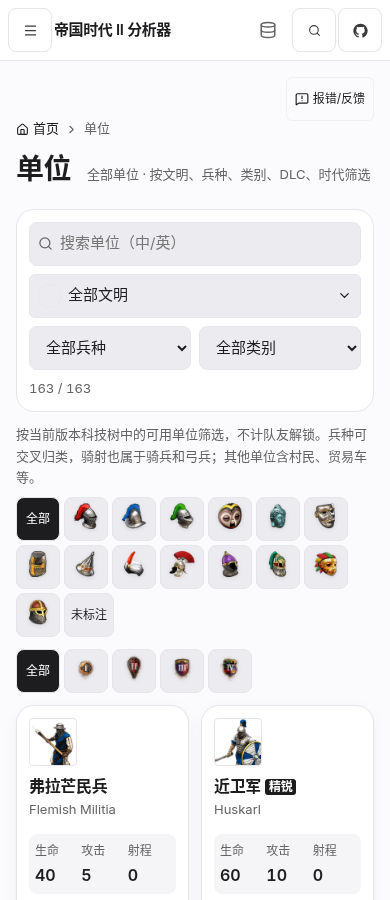  | 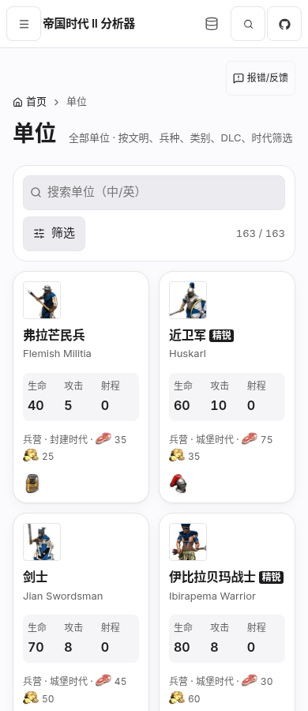  |
| 文明列表     | 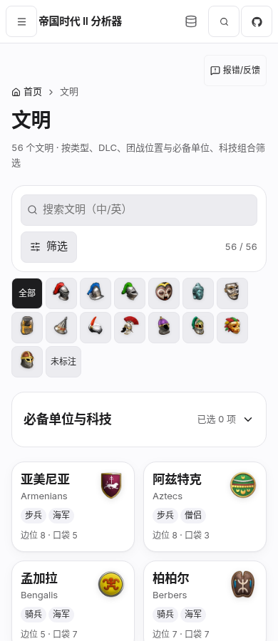   | 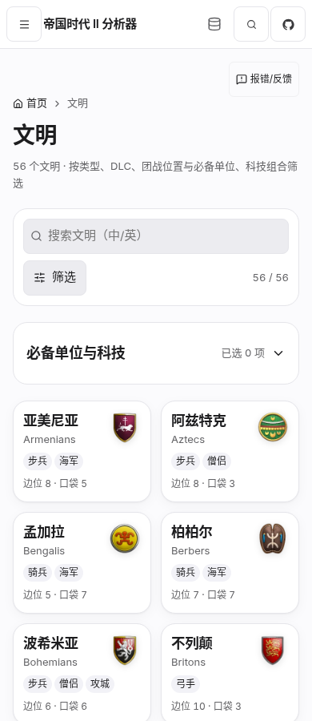   |
| 已有场景推荐 | 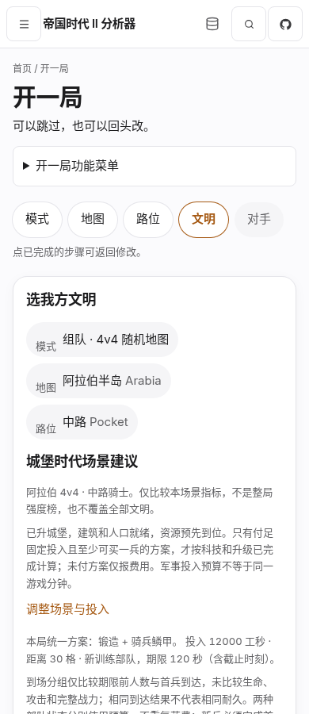  | 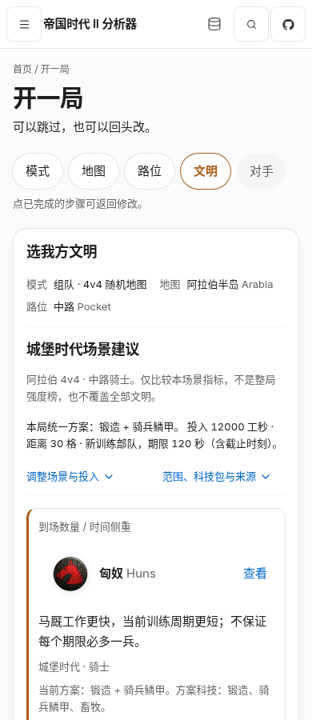  |
| 骑士详情     | 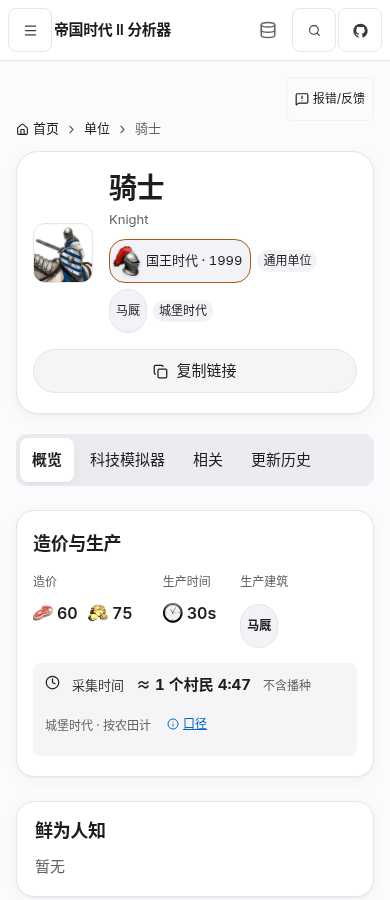 | 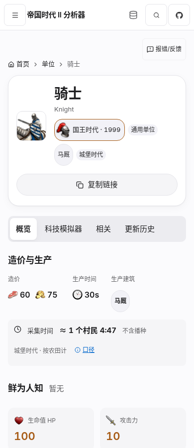 |

1280px 主要对比

| 页面         | 优化前                                                                           | 优化后                                                                          |
| ------------ | -------------------------------------------------------------------------------- | ------------------------------------------------------------------------------- |
| 单位列表     | 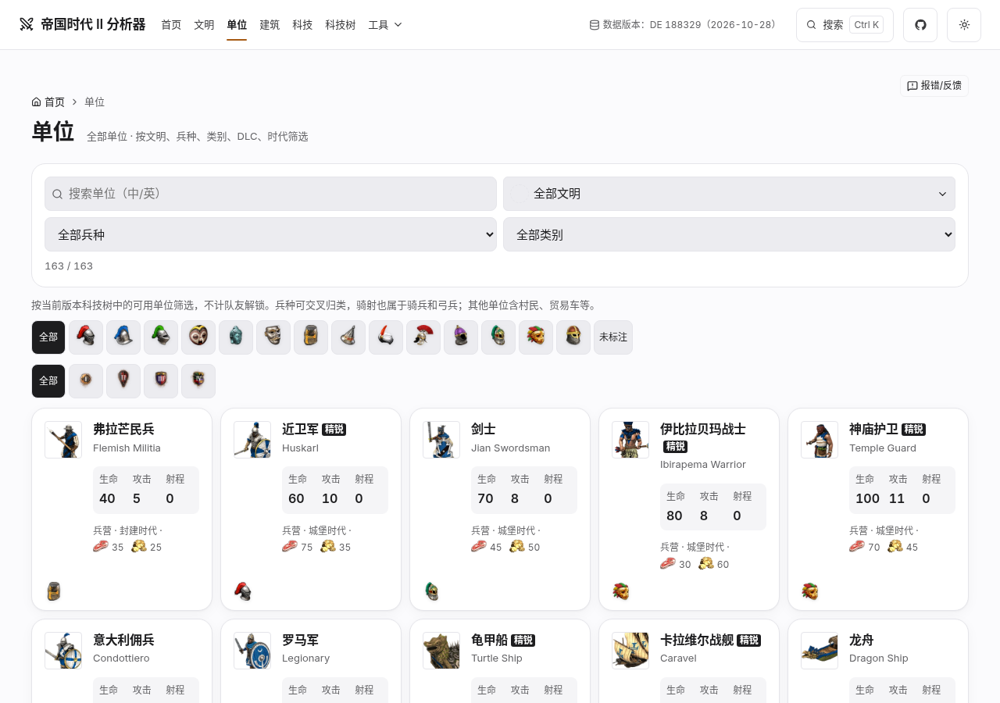  | 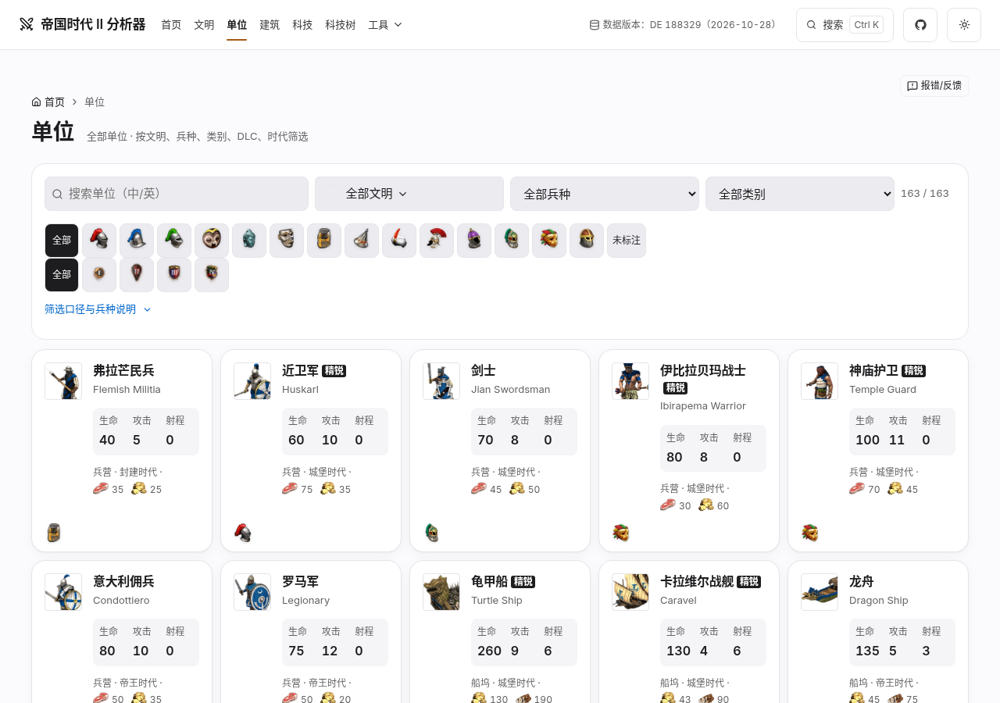  |
| 文明列表     | 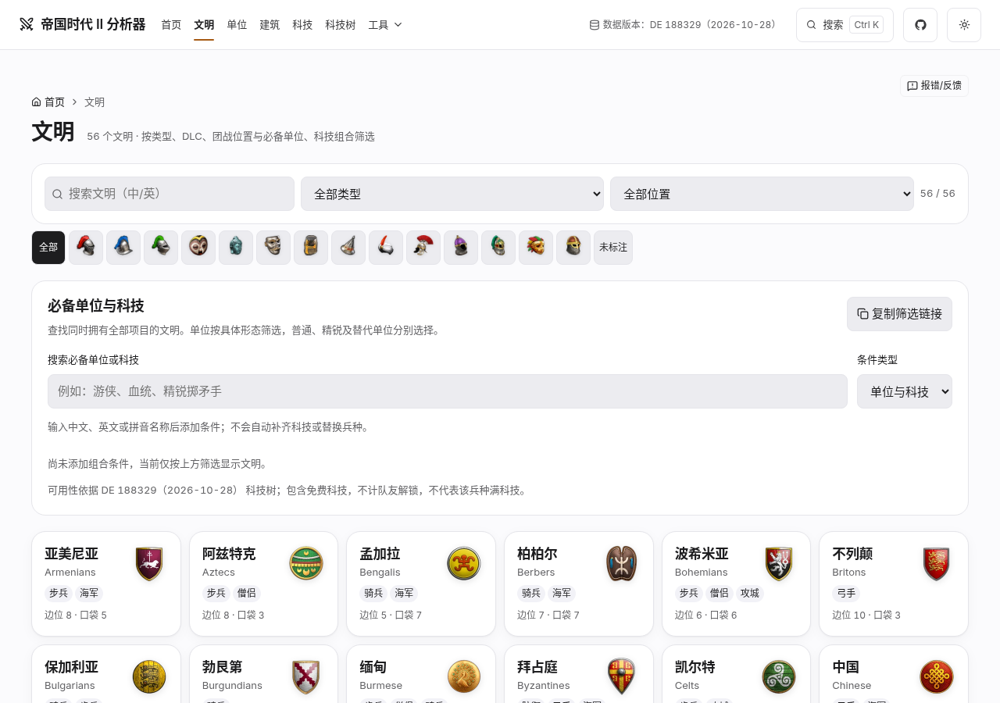   | 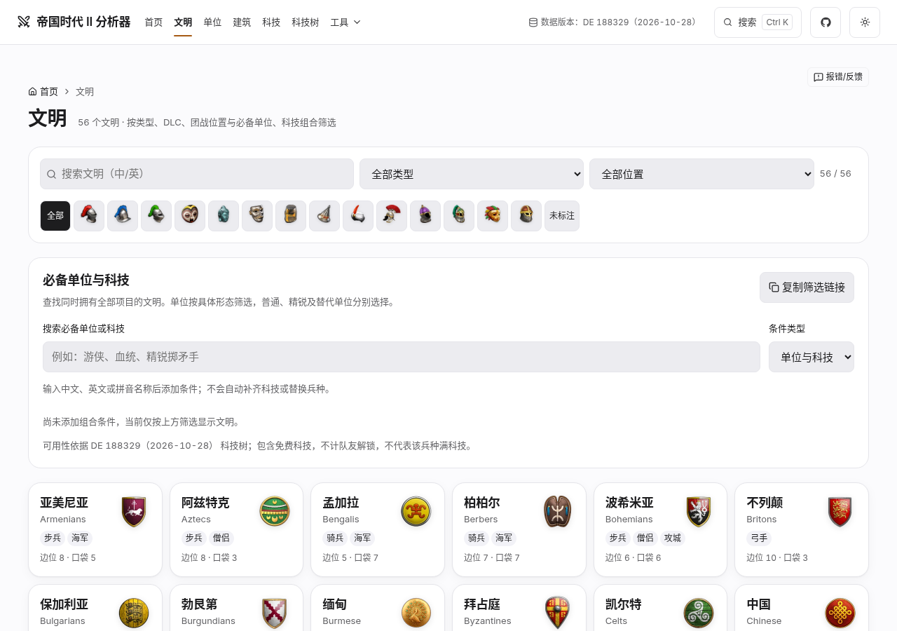   |
| 已有场景推荐 | 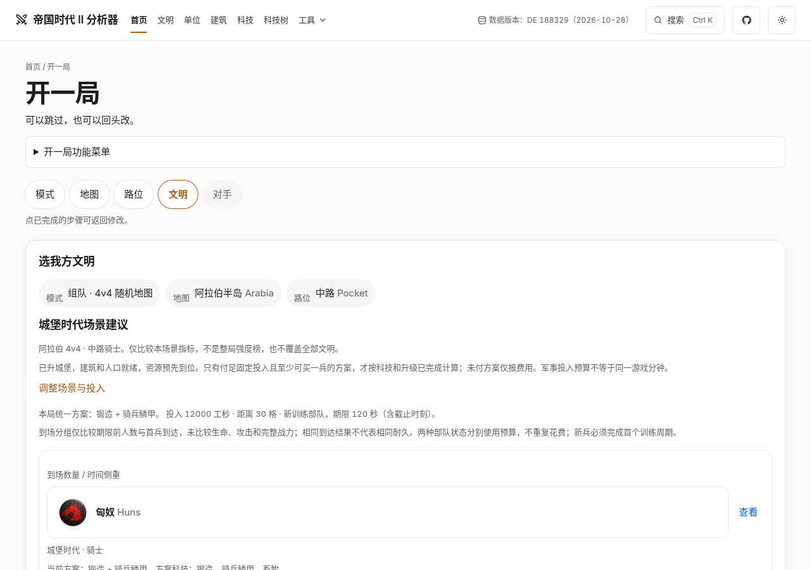  | 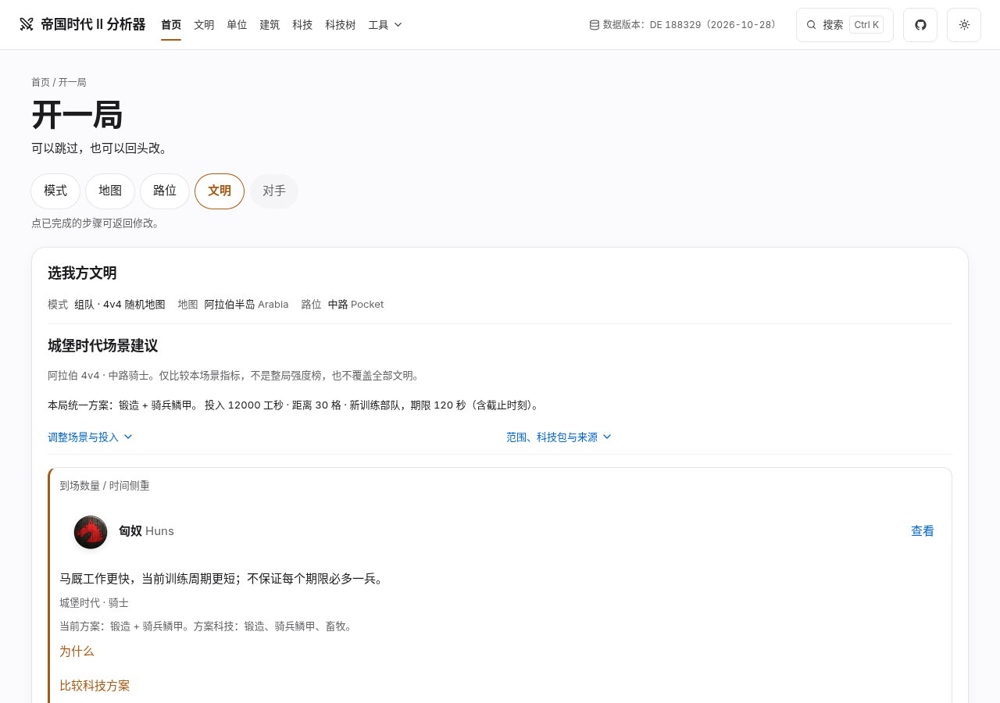  |
| 骑士详情     | 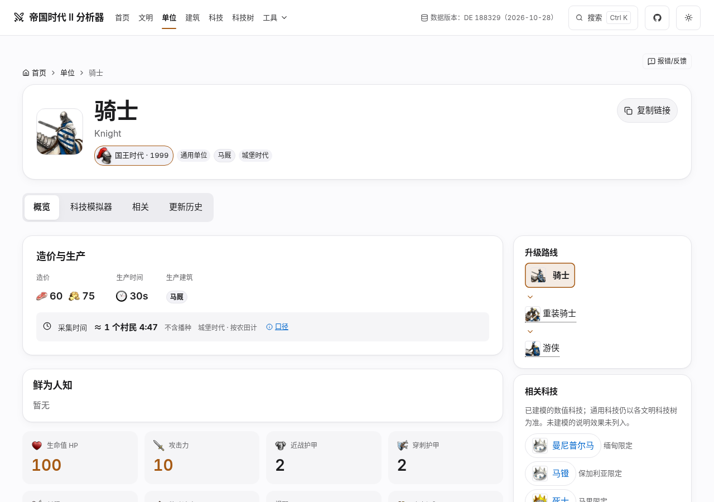 | 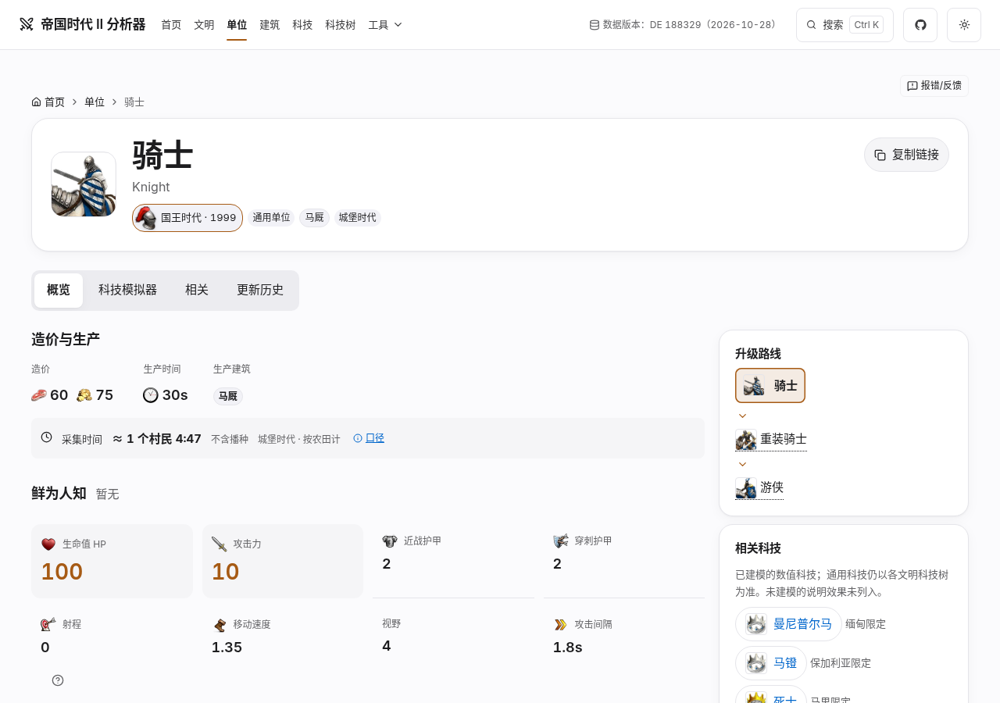 |

## 实际参考与取舍

调研日期：2026-11-09。都经过真实浏览器访问与交互，借用信息组织方式，不复制品牌风格。

| 问题               | 参考                                                                                                                                                                                             | 可迁移思想                                         | 明确不借用                                                               |
| ------------------ | ------------------------------------------------------------------------------------------------------------------------------------------------------------------------------------------------ | -------------------------------------------------- | ------------------------------------------------------------------------ |
| 复杂列表与手机筛选 | [pub.dev 搜索](https://pub.dev/packages?q=http)；[手机默认](references/pub-list-390.png)、[展开筛选](references/pub-list-filter-390.png)、[桌面](references/pub-list-1280.png)                   | 查询和结果数常驻，次要筛选披露，默认态先展示结果   | 纯图标入口的发现性、非button的语义实现、长标签堆叠                       |
| 参数决策与推荐操作 | [Node.js 下载](https://nodejs.org/en/download)；[手机默认](references/node-download-390.png)、[切换Windows](references/node-download-windows-390.png)、[桌面](references/node-download-1280.png) | 当前参数紧邻推荐操作，后置高级信息                 | 大型代码卡、重复且独立的平台选择；它不是完整编号向导，也不能证明游戏模型 |
| 数据密集详情       | [pub.dev http](https://pub.dev/packages/http)；[桌面](references/pub-detail-1280.png)、[手机](references/pub-detail-390.png)、[Metadata](references/pub-detail-metadata-390.png)                 | 核心数值集中，次要元信息用小标题、间距和分隔线平铺 | 手机多排标签页、整页品牌风格                                             |

另外实测 crates.io、PyPI、RubyGems 和 NuGet，将过高的纵向导航与展开筛选作为不采用的模式。GitHub 的样式资源受限，Linear/Stripe 连接失败，未将它们冒作有效视觉证据。部分第三方 README 徽章在本环境破图，不据此判断其真实产品故障。详细取舍见 [完整调研记录](research-notes.txt)。

## 验证和复核

- 正式构建、静态检查、设计令牌对比度通过；相关单测 **146/146** 通过。
- 原相关浏览器范围 **167条，最终164通过**；**3条资源失败重试用例在干净基线构建也复现失败**，原断言保留，未绕过。
- 追加的组合筛选、资料卡和四宽/浅深主题 UI 检查 **36/36** 通过；单位筛选及DLC各 **10/10** 复测通过。
- 360/375/390/1280 检查无页面横向溢出、无console/pageerror；资料卡另覆盖1920。核心键盘操作、隐藏Tab隔离、嵌套Escape、跨页状态与断点回焦通过。
- 本轮修改的五类页面及场景默认态 Axe WCAG A/AA通过。**科技树仅审计，既有#trm缺少可访问名称仍保留**，不能宣称全站axe零问题。
- 实施者之外的独立代理完成规格、源码与页面复核，最终无未解决阻塞。原有中文限制/前提/来源通过AST对照，候选顺序、计算、数据、URL/存储协议无改动。

[验证证据与独立复核记录](verification.md) 列出实际命令、原始日志、已知失败和精确边界。这里是本地实现与审阅证据，不能代表生产已经发布。
